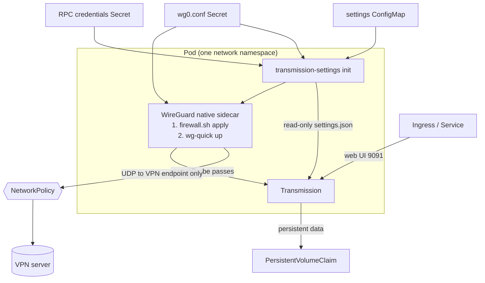

# transmission-wireguard Architecture

- Both containers share one network namespace, so the kill switch and the tunnel apply to Transmission.
- `files/firewall.sh` installs default-deny iptables/ip6tables rules in that namespace before `wg-quick` runs. The namespace outlives container restarts, so the rules do too; `wg-quick down` never touches them.
- Replies to connections that arrived from the cluster (kubelet probes, ingress) carry WireGuard's fwmark so `wg-quick`'s policy routing sends them out `eth0`; everything else is routed into `wg0` or rejected.
- Outbound, only unmarked packets may use `wg0`. Packets with WireGuard's fwmark leave `eth0` only as UDP to the `Endpoint` addresses, or as replies on connections from the cluster, so whatever marks a packet (a stray mangle rule, `SO_MARK`) can't open `eth0`.
- The last rule of each chain carries a hash of the rules before it. The probes check the policies, the jump order, that mangle `OUTPUT` holds nothing but the jump, and that hash, so any rule added, removed or changed fails the liveness probe and the restart re-applies the rules.
- The startup probe passes only when `wg-quick` has finished: `wg0` has its address and the fwmark policy rule exists. On start, `firewall.sh` also cleans up what a killed `wg-quick` leaves behind (the interface, its policy rules and nft table) and restores the default route if the image removed it.
- The WireGuard container is a native sidecar (`initContainers` with `restartPolicy: Always`), so Transmission starts only after its startup probe confirms the kill switch and tunnel.
- `files/settings-init.sh` composes `settings.json` (chart settings, RPC credentials, bind address from `wg0.conf`) into a memory-backed volume mounted read-only.
- The NetworkPolicy is a second, independent layer enforced by the CNI outside the pod.
- `templates/tests/leak-test.yaml` is the `helm test`: it execs into the running pod to check the rules, `eth0`, DNS and the public address.
- Tests: `tests/*.yaml` (helm-unittest), `tests/e2e/netns-leak-test.sh` (Docker, amd64 and arm64), `tests/e2e/kind-test.sh` on clusters from `tests/e2e/kind-cluster.sh` (kindnet dual-stack, Calico, Cilium).
