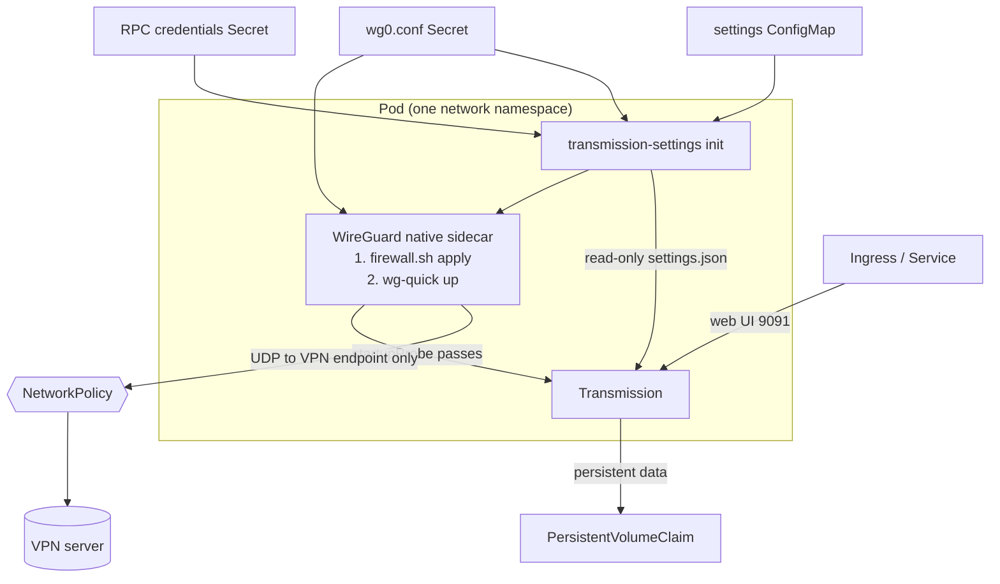

# transmission-wireguard Architecture

- Both containers share one network namespace, so the kill switch and the tunnel apply to Transmission.
- `files/firewall.sh` installs default-deny iptables/ip6tables rules in that namespace before `wg-quick` runs. The namespace outlives container restarts, so the rules do too; `wg-quick down` never touches them.
- Replies to connections that arrived from the cluster (kubelet probes, ingress) carry WireGuard's fwmark so `wg-quick`'s policy routing sends them out `eth0`; everything else is routed into `wg0` or rejected.
- The final outbound decision is made in mangle `POSTROUTING` (`TWG-POSTROUTING`), which sees the interface a packet really leaves by; filter `OUTPUT` only sees the route chosen before mangle or nat rules re-routed it. Both allow the same traffic, so a re-routed packet is dropped there.
- Outbound, only unmarked packets may use `wg0`. Packets with WireGuard's fwmark leave `eth0` only as UDP to the `Endpoint` addresses, or as replies from the web port to `webAllowedCIDRs` on connections the web UI rule let in (reply direction only), so whatever marks a packet or a connection (a stray mangle or `CONNMARK` rule, `SO_MARK`, `conntrack -U`) can't open `eth0`. The web UI rule itself requires the connection mark, so a connection that arrives while the mangle rules are being rebuilt is dropped rather than answered through the tunnel.
- Router advertisements on `eth0` may set the default route but not add on-link prefixes or routes (`accept_ra_pinfo`, `accept_ra_rt_info_max_plen`), which would beat the tunnel's `/0`. An unprivileged sidecar can't write those sysctls and logs a warning instead.
- `apply` also refuses a config without `MTU` when the route to the endpoint has an MTU above 1500 (jumbo frames would make `wg-quick` pick a tunnel MTU the internet fragments), and an `Address` other than the one Transmission was bound to (`/twg/run/tunnel.env`, which the init container writes next to `settings.json` without the credentials), since the Secret can change under a running pod.
- The last rule of each chain carries a hash of the rules before it. The probes check the policies, the jump order (including the first jump in mangle `POSTROUTING`), that mangle `OUTPUT` holds nothing but the jump, that no nft `dup`/`fwd` or `TEE` rule copies packets past the chains, that no tc filter (which acts after `POSTROUTING`) exists on any interface, and that hash, so any rule added, removed or changed fails the liveness probe and the restart re-applies the rules.
- The startup probe passes only when `wg-quick` has finished: `wg0` has its address and the fwmark policy rule exists. On start, `firewall.sh` also cleans up what a killed `wg-quick` leaves behind (the interface, its policy rules and nft table) and restores the default route if the image removed it.
- The WireGuard container is a native sidecar (`initContainers` with `restartPolicy: Always`), so Transmission starts only after its startup probe confirms the kill switch and tunnel.
- `files/settings-init.sh` composes `settings.json` (chart settings, RPC credentials, bind address from `wg0.conf`) into a memory-backed volume mounted read-only.
- `files/transmission-live.sh` is Transmission's liveness probe. Transmission binds its peer port once, at start, and never retries; started while the tunnel address was missing, it would never accept a peer. The probe fails when the address exists but nothing listens on it there, and passes while the address is missing (a restart then could not bind either).
- The pod opts out of Istio (sidecar and ambient) and Linkerd: a mesh proxy can't reach its control plane through the kill switch, and ambient mode would add its own rules to the namespace.
- The NetworkPolicy is a second, independent layer enforced by the CNI outside the pod.
- `templates/tests/leak-test.yaml` is the `helm test`: it execs into the running pod to check the rules, `eth0`, DNS and the public address.
- Tests: `tests/*.yaml` (helm-unittest), `tests/schema-test.sh`, `tests/metadata-test.sh`, `tests/package-test.sh` (the package's contents), the bats suites `tests/e2e/docker/` (Docker, amd64 and arm64, and with an unprivileged sidecar; `tests/e2e/docker-test.sh`) and `tests/e2e/cluster/` (`tests/e2e/cluster-test.sh`) on kind clusters from `tests/e2e/kind-cluster.sh` (kindnet dual-stack, Calico, Cilium; Kubernetes 1.29 to 1.37, Helm 3 and 4; also as an upgrade from the last release) or a local k3d cluster from `tests/e2e/k3d-cluster.sh`, and `tests/e2e/mutation-test.sh`, which turns off one firewall rule at a time and requires the Docker suite to fail (except for the rules in `tests/e2e/mutation-baseline.txt`, each with its reason). Each suite builds its environment once; each check is one named test that leaves the environment healthy. The e2e tests count leaked packets where they would arrive: at every canary, at the VPN server (plaintext from the pod) and in the pod itself (every new flow out `eth0` other than WireGuard's, whatever its destination), each with a positive control.
## Threats and the tests that cover them

Each way traffic could get out, or the release could break, and where it is tested (`docker/` and `cluster/` are the suites under `tests/e2e/`). A new threat needs a row and a test; a new firewall rule needs a check that fails without it (`make mutation LINES=<line>`).

| Threat | Covered by |
|---|---|
| An app socket bound to `eth0`, or sent to a more specific or link-local route | `docker/02-egress`, `cluster/20-egress` |
| DNS or other UDP outside the tunnel | `docker/03-dns`, `cluster/20-egress`, `cluster/30-dns-and-service` |
| ICMP outside the tunnel | `docker/02-egress`, `docker/05`, `docker/07`, `docker/16` |
| IPv6 when the tunnel has none, or router advertisements adding routes past it | `docker/16-ipv4-only-tunnel`, `docker/01-setup` |
| Transmission's own trackers and peers outside the tunnel; peers unable to reach it through the tunnel (TCP and UDP) | `docker/04-transmission`, `docker/05-policy-rule-gone` |
| Transmission started while the tunnel address was missing, never binding its peer port | `docker/09-transmission-tunnel-down`, `cluster/80-liveness` |
| The tunnel's routing gone: wg-quick's policy rule deleted, `wg0` deleted, the sidecar restarted or SIGKILLed | `docker/05`, `docker/06`, `docker/07`, `docker/08`, `cluster/50-restarts` |
| The firewall tampered with: rules inserted, nft rules duplicating packets, filter OUTPUT flushed, every packet marked, nat re-routes | `docker/10` to `docker/13`, `cluster/55-marked-packets`, `cluster/40-helm-test` |
| The VPN server roaming to another address; a stale tunnel without handshakes | `docker/15-server-roaming`, `docker/14-stale-handshake` |
| Failing over to another server: switching too early, not at all, or leaking while it switches | `docker/19-failover` |
| An unsafe `wg0.conf` or setting (hooks, split tunnels, hostnames, marks, tables, MTU, a changed `Address`) | `docker/17-refusals`, `cluster/70-refusals` |
| Web UI replies to cluster clients leaving by the wrong path (into the tunnel, or blocked by strict reverse-path filtering), or the web UI reachable from the VPN side | `docker/04-transmission`, `docker/18-web-ui-replies`, `cluster/30-dns-and-service` |
| Cluster DNS or the Kubernetes API reached outside the tunnel | `cluster/30-dns-and-service` |
| The in-pod kill switch gone entirely (the NetworkPolicy must hold) | `cluster/60-networkpolicy` |
| Leaks while the pod shuts down; Transmission killed instead of stopping cleanly | `cluster/90-termination` |
| Start order: Transmission before the kill switch and tunnel | `cluster/10-start` |
| An upgrade from the last release failing, or losing the downloads | `cluster/10-start` (upgrade runs) |
| A rule no test depends on | `tests/e2e/mutation-test.sh` |

- CI downloads nothing from GitHub releases: tools come from container images by digest, the Go module proxy (kind) or dl.k8s.io (kubectl), and the CNI manifests from jsDelivr and quay.io, each pinned by checksum.
- CI: require the `ci-passed` job in branch protection; it fails unless every test job passed (GitHub counts a skipped job as passed).
