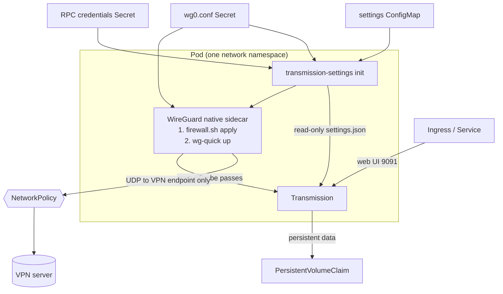

# transmission-wireguard Architecture

- Both containers share one network namespace, so the kill switch and the tunnel apply to Transmission.
- `files/firewall.sh` installs default-deny iptables/ip6tables rules in that namespace before `wg-quick` runs. The namespace outlives container restarts, so the rules do too; `wg-quick down` never touches them.
- Replies to connections that arrived from the cluster (kubelet probes, ingress) carry WireGuard's fwmark so `wg-quick`'s policy routing sends them out `eth0`; everything else is routed into `wg0` or rejected.
- The WireGuard container is a native sidecar (`initContainers` with `restartPolicy: Always`), so Transmission starts only after its startup probe confirms the kill switch and tunnel.
- `files/settings-init.sh` composes `settings.json` (chart settings, RPC credentials, bind address from `wg0.conf`) into a memory-backed volume mounted read-only.
- The NetworkPolicy is a second, independent layer enforced by the CNI outside the pod.
- Tests: `tests/*.yaml` (helm-unittest), `tests/e2e/netns-leak-test.sh` (Docker), `tests/e2e/kind-test.sh` (kind).
